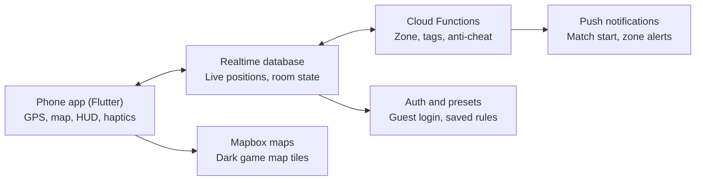

# Snoopzy: Hide & Seek IRL — Product Documentation

Last updated: 2026-10-29

## Vision

Snoopzy is a real-world multiplayer game where friends use their phones' live GPS to play hide and seek, battle royale and more, outdoors, in any park, campus or street.

**One-line pitch:** *PUBG meets hide and seek, played on your actual neighbourhood.*

**Who it is for:** friend groups aged 13 to 30 who want a reason to go outside together: college mates, cousins, colony friends, office teams.

**Why it works:**

- No consoles or gear. Just a phone and a code.
- Every rule is customizable, so each group invents its own version.
- Short rounds (10 to 30 minutes) that fit an evening or a break.
- Social by design: it needs friends in the same place.

**Brand:** the name suggests snooping and sneaking. Tagline: *Snoopzy: Hide & Seek IRL* (IRL means in real life).

## Game modes

Four launch modes share one engine; the host picks a mode and then tunes its rules.

| Mode | How it plays | Win condition | Players |
| --- | --- | --- | --- |
| Hide & Seek | Hiders get a head start to hide inside the zone. Seekers hunt using timed pings and radar. | Seekers tag all hiders, or hiders survive until the timer ends. | 3 to 12 |
| Battle Royale | Everyone starts spread out. The safe zone shrinks on a schedule. Tag or tap-eliminate rivals nearby. | Last player (or team) standing inside the zone. | 4 to 20 |
| Capture the Flag | Two teams each guard a GPS flag point. Grab the rival flag and bring it home. | First team to capture the target number of flags. | 6 to 16 |
| Zombie Tag | One player starts infected. Touching a survivor infects them. Safe spots give short immunity. | Zombies infect everyone, or survivors last until the timer ends. | 5 to 20 |

**Later modes (ideas):** Treasure Hunt (reach hidden GPS drops), Assassin (secret targets, one per player).

**Play style options:** free-for-all, teams, or *asymmetric* (one hunter vs many runners).

## Customizable rules engine

Every match is defined by a rules object the host edits in the lobby. Players see the final rules before they ready up. Hosts can save rule sets as presets and share them with a link or code.

| Category | Setting | Example values |
| --- | --- | --- |
| Map | Play area | Draw polygon, or pin + radius (100 m to 2 km) |
| Map | No-go areas | Roads, private property, water (host marks them) |
| Timing | Hiding head start | 30 s to 5 min |
| Timing | Round length | 5 to 60 min |
| Zone | Shrink schedule | Every 3 / 5 / 10 min, final radius 20 m |
| Zone | Out-of-zone penalty | Slow health loss, warning only, or instant out |
| Roles | Seekers | Random, host-picked, or first to join |
| Roles | Teams | Free-for-all, 2 teams, custom names and colours |
| Tagging | Tag method | Proximity (within 3 to 10 m), tap + confirm, or QR scan |
| Tagging | Lives | 1 life, 3 lives, or respawn after a cooldown |
| Visibility | Hider location pings | Never, every 60 s, or only when tagged near |
| Visibility | Seeker radar | On / off, range 20 to 100 m, vague direction only |
| Power-ups | Spawn points | Off, random, or host-placed |
| Power-ups | Allowed types | Decoy, speed ping, shield, reveal |
| Safety | Max speed | Flag players moving above running speed (anti-vehicle) |
| Safety | End time | Hard stop for the match |

**Presets (examples):** *Classic Park Hide & Seek*, *Campus Royale*, *Quick 10-min Blitz*, *Night Mode* (dim UI, low-light safe zones).

**Rules for the rules:** only the host can edit; changes lock at countdown; every rule has a one-line plain-language explanation in the UI.

## Player flow

A match runs in six steps, from opening the app to the results screen.

1. **Sign in fast.** Pick a nickname, avatar and colour. Guest play works with no account.
2. **Create or join.** The host taps Create and gets a 6-character code and QR. Friends enter the code or scan the QR.
3. **Lobby.** Everyone sees who joined. The host picks the mode, draws the play area and edits rules. Players tap Ready. Location permission is requested here.
4. **Countdown.** Roles are assigned and rules lock. Hiders get their head-start timer; seekers see a frozen screen with a countdown.
5. **Live match.** Live map, zone ring, timers, radar and actions. Eliminated players become spectators with a live view.
6. **Results.** Winner banner, route replay of all players, stats (distance, tags, survival time) and a *Play again* button that reuses the same room and rules.

**If someone drops:** their dot greys out for 60 s, then they are marked disconnected. The host can pause, kick or let the match continue.

## Screens and UI/UX

**Visual style:** dark map by default with neon accents (lime, hot pink, electric blue), chunky rounded type, sticker-style avatars and playful sound effects. Big thumb-friendly buttons, because players are often running.

| Screen | What the player sees |
| --- | --- |
| Home | Create room, Join with code, saved presets, recent matches |
| Lobby | Room code + QR, player avatars, ready toggles, host rules panel, chat and emoji reactions |
| Rules editor | Cards per category with plain-language hints, preset picker, a map preview of the play area |
| Live map (HUD) | Dark map, zone ring with countdown, your dot, teammates, timer, players alive, action buttons |
| Radar | Circular pulse view showing vague direction and distance bands of nearby players, no exact positions |
| Tag / action sheet | Big Tag button, ability buttons, SOS in a corner |
| Spectator | Free map view of all remaining players, reactions to cheer friends |
| Results | Winner banner, route replay, awards (Sneakiest, Fastest, Most tags) and Share |

**Design principles:**

- One thumb, one glance: key info (timer, zone, alive count) in the top bar.
- Haptics and sound carry urgency: heartbeat pulse as an enemy approaches, buzz when the zone shrinks.
- Accessible: high-contrast mode, colour-blind-safe team colours, adjustable text size.
- Battery-saver mode with a simpler map and lower update rate.

## Fun features

These make Snoopzy feel like a game and not just a tracker. All are optional in the rules engine.

- **Radar pulse:** a ping shows the rough direction and distance band of the nearest rival, never an exact spot.
- **Heartbeat haptics:** the phone vibrates faster as a seeker gets closer to a hider.
- **Power-ups at GPS drops:** walk to a marked spot to collect a Decoy (fake dot for 30 s), Shield (survive one tag), Speed Ping (reveal one rival briefly) or Ghost (hide from radar for 20 s).
- **Shrinking zone:** a glowing ring tightens on schedule with a countdown and a warning buzz.
- **Emote and taunts:** quick sticker reactions to friends in lobby and after elimination.
- **Spectator mode:** eliminated players watch live and can cheer or trigger harmless map pings.
- **Awards and recap:** Sneakiest Hider, Fastest Seeker, Last Dot Standing, plus a shareable route-replay clip.
- **Streaks and cosmetics:** avatar skins, tag effects and zone colours unlocked by playing (no pay-to-win).

## Tech architecture

A Flutter app streams each player's GPS to a realtime database; server-side functions decide what counts (zone checks, tags, eliminations) so a modified phone cannot cheat.

The database is the single source of truth, and functions are the only writers of match results.

| Layer | Choice | Why |
| --- | --- | --- |
| App | Flutter (Android first, iOS next) | One codebase, smooth map animation |
| Maps | Mapbox | Custom dark game style, offline tiles |
| Backend | Firebase (Realtime DB, Auth, Functions, FCM) | Fastest to build, built-in live sync |
| Location | Foreground service on Android, background modes on iOS | Keeps GPS alive when the screen dims |
| Update rate | 2 to 5 s while moving, 10 to 15 s when still | Balances accuracy and battery |
| Room codes | 6 characters, no look-alike letters, expire in 24 h | Easy to type and share |
| Scale path | Move hot paths to a custom WebSocket server if rooms grow | Only if Firebase cost or latency becomes a limit |

**Battery:** adaptive update rate, pause GPS for eliminated players, battery-saver mode, and a low-power warning before a match starts.

## Data model

Six core records. Positions are short-lived and deleted when a match ends.

| Record | Key fields | Notes |
| --- | --- | --- |
| User | id, nickname, avatar, colour, stats | Guest users get a temporary id |
| Room | code, hostId, mode, status (lobby, live, ended), rulesId, area polygon | Code expires in 24 h |
| Rules | JSON of every setting (timing, zone, tagging, visibility, power-ups) | Saved as presets; versioned |
| Player | roomId, userId, role, team, status (alive, tagged, out, offline), lives | One per user per room |
| Position | playerId, lat, lng, accuracy, speed, timestamp | Latest only; history kept for replay if consented |
| Event | roomId, type (tag, zone-shrink, power-up, elimination), actors, time | Drives the results recap and replay |

**Rules are data, not code:** the app and the functions both read the same rules JSON, so adding a new setting needs no new screen logic beyond one rule card.

## Fair play, safety and privacy

Snoopzy is played outdoors with real people, so safety rules are part of the product and not an afterthought.

**Fair play (anti-cheat)**

- Server checks every position: impossible speed or teleport jumps are flagged.
- Mock-location and rooted-device detection on Android.
- Tags and eliminations are decided by functions, never by the phone alone.
- Low GPS accuracy (over 25 m) pauses tagging for that player instead of punishing them.

**Player safety**

- First-run safety card: stay off roads, no trespassing, play in daylight or lit areas.
- Host marks no-go areas; entering one triggers a warning.
- SOS button sends the player's location to chosen friends and pauses the match for them.
- Speed warning: if a player moves at vehicle speed, they are asked to stop and are flagged.
- Age rule: under-18 players require the host to confirm a parent or guardian knows.

**Privacy**

- Location is shared only during a live match, only with players in that room.
- Exact positions are deleted when the match ends; replay data is kept only if all players opt in.
- Clear permission screen explaining why location is needed, with no tracking outside matches.
- Compliance to check before launch: Google Play and App Store location policies, India's DPDP Act, GDPR if released in the EU.

## Roadmap and milestones

The MVP (Hide & Seek, playable with friends) lands by week 8; Battle Royale and polish follow by week 12. Each phase ends with a real-world test.

| Phase | Weeks | Build | Exit check |
| --- | --- | --- | --- |
| 0. Design | 1 to 2 | Brand, UI kit, wireframes, rules schema, clickable prototype | Friends react to the prototype |
| 1. Core engine | 3 to 5 | Auth, room codes, lobby, live GPS sync on the map | 4 phones show each other live in a park |
| 2. Hide & Seek MVP | 6 to 8 | Roles, timers, tagging, radar, results screen | A full 15-minute match with 6 friends |
| 3. Rules editor + Royale | 9 to 10 | Customizable rules, presets, shrinking zone, spectator | Host builds a custom match in under 2 minutes |
| 4. Polish + safety | 11 | Anti-cheat, SOS, battery tuning, sound and haptics | Battery use under 12% for a 30-minute match |
| 5. Beta | 12 | Play Store closed beta, then TestFlight, feedback form | 30 testers, crash-free rate above 98% |

**After launch:** Capture the Flag, Zombie Tag, power-up drops, cosmetics, shareable route replays, friends list and clans.

## Risks, decisions and monetization

**Risks**

| Risk | Impact | Mitigation |
| --- | --- | --- |
| GPS drift in dense areas | Unfair tags | Accuracy threshold, wider tag radius, tag confirm |
| Battery drain | Players quit early | Adaptive updates, battery-saver mode |
| Players in unsafe places | Real-world harm | Safety card, no-go zones, speed flags, SOS |
| Name overlap (Snoopza spy app) | Store confusion | Tagline "Hide & Seek IRL", check trademarks early |
| Cheating via fake GPS | Ruined matches | Server validation, mock-location detection |
| Too few friends online | Low retention | Quick presets, 2-player mode, share links |

**Decisions so far**

- **Platform:** Android first, iOS after the beta.
- **Launch modes:** Hide & Seek, Battle Royale, Capture the Flag and Zombie Tag. Build order: Hide & Seek, then Battle Royale, then Zombie Tag and Capture the Flag, since all share one engine.
- **Chat:** lobby text chat plus voice chat. Voice needs a real-time audio service (for example WebRTC through LiveKit or Agora), so it ships after the MVP; text chat and emoji come first.
- **Money:** stay free for now. Cosmetics stay a later option.
- **Still open:** hosting budget, final app icon and colours, and whether under-18 players are officially supported.

**Monetization ideas (later)**

- Cosmetic skins, tag effects and zone themes (no pay-to-win).
- Premium rooms: bigger player counts, saved presets, replay clips.
- Sponsored maps for campuses, cafes and events.
